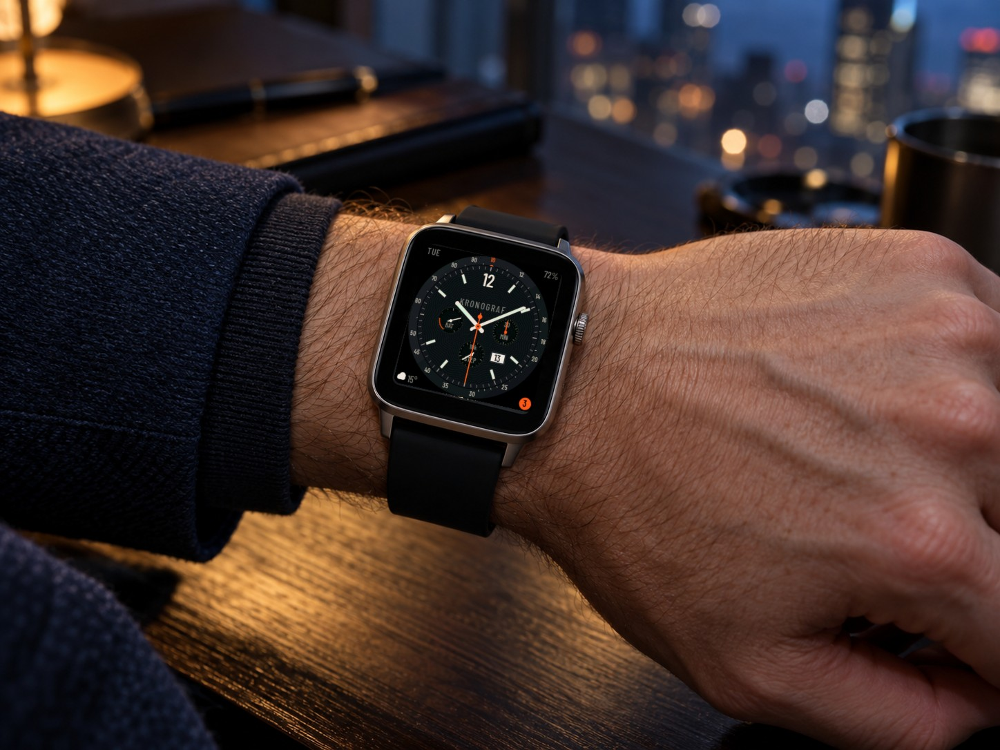
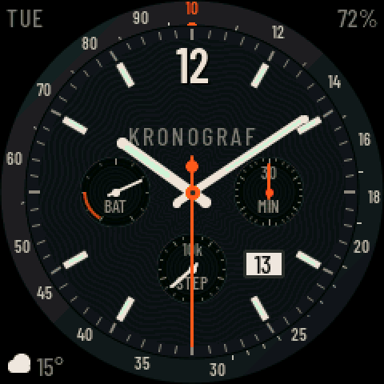
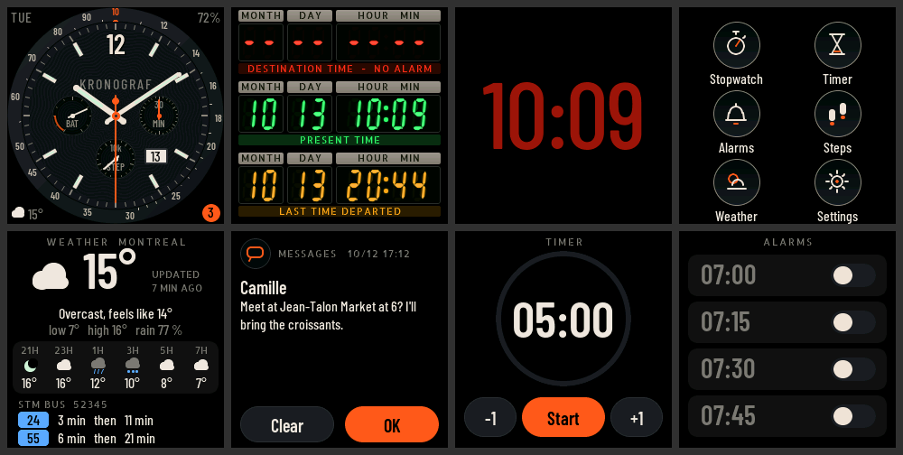

# Kronograf

[](https://github.com/storagebits/kronograf/actions/workflows/ci.yml)
[](LICENSE)

**A from-scratch firmware for the LilyGO T-Watch 2020**: an aviation chronograph face, "time circuits" 7-segment displays straight out of *Back to the Future*, Montréal weather and real-time bus departures, and iPhone notifications. ESP32, LVGL 8.3, and a macOS simulator that builds exactly the same interface.


<sub>AI-generated photo; the display shows a real screenshot of the aviator face, inlaid with `tools/inlay_screen.py`.</sub>

<p align="center">
  
</p>



## What the watch does

| | |
|---|---|
| **Faces** | *Aviator chronograph* (smooth hands, battery / minutes / steps sub-dials, date window, weather complication, notification badge) · *Time circuits* (three 7-segment rows: next alarm, present time, last sync) · *Night* (time only, dark red, dimmed backlight). Swipe sideways between faces. |
| **Apps** | Stopwatch, timer, alarms, 7-day step history, weather + buses, settings — a 2 × 3 launcher drawn like a set of sub-dials. |
| **Weather** | [Open-Meteo](https://open-meteo.com) (no key needed): conditions, feels-like, the next 6 hours, vector pictograms; age of the reading or "offline". |
| **STM buses** | Real-time departures at up to 3 chosen stops, from the STM GTFS-realtime feed (~1 MB, parsed as a stream on the watch, pinned certificate). Optional API key. |
| **iPhone** | Notifications over ANCS (Bluetooth Low Energy): a card with vibration on arrival, a list, and "Clear" or "Decline" sent back to the iPhone. Pairing protected by a 6-digit passkey. |
| **Time** | On-demand NTP (Wi-Fi on for a few seconds, then off), PCF8563 RTC as a fallback. |
| **Power** | Light sleep with the screen off; wake on button, wrist raise or double tap (BMA423); alarms and timers fire on time while asleep. |

Fonts are OFL-licensed and keep their accented glyphs, so notifications in any Latin-1 language display correctly. Hardware missing from a board revision (GPS, SD card…) is detected at boot and never shows up in the interface.

## Hardware

LilyGO **T-Watch 2020 V1** (ESP32-D0WDQ6, 16 MB flash, 4 MB PSRAM, 240 × 240 ST7789 display, AXP202, BMA423, PCF8563, FT6336, vibration motor, MAX98357A speaker, infrared). V2 and V3 environments exist in `platformio.ini`, but only the V1 has been tested.

## Getting started

```sh
brew install platformio sdl2 cmake
git clone --recurse-submodules https://github.com/storagebits/kronograf.git && cd kronograf
cp include/secrets.example.h include/secrets.h   # optional: Wi-Fi, STM key, OTA password
```

### Simulator (macOS)

```sh
cmake -S sim -B sim/build -DCMAKE_BUILD_TYPE=Release && cmake --build sim/build -j8
sim/build/kronograf_sim                                       # ×3 window, the mouse is your finger
KG_TIME=10:09:30 sim/build/kronograf_sim --shot shot.png      # headless PNG screenshot
tools/make_demo_gif.sh                                        # re-records the demo GIF (ffmpeg)
```

The simulated HAL is driven by environment variables: `KG_TIME`, `KG_FACE`, `KG_APP` (`chrono`, `weather`, `notifs`…), `KG_BATT`, `KG_STEPS`, `KG_REV`, `KG_WX_CODE`, `KG_WX_TEMP`, `KG_BUS_STOPS`, `KG_BLE`, `KG_NOTIF_CAT`, `KG_ALERT`…

### Watch

**Prebuilt firmware**: every [release](https://github.com/storagebits/kronograf/releases) ships binaries built by GitHub Actions, with no credentials inside, and flashing instructions. Wi-Fi and the STM key are then set up on the watch.

**From source:**

```sh
# First of all: back up the original flash (16 MB, a few minutes)
tools/backup_flash.sh

pio run -e twatch-v1 -t upload --upload-port /dev/cu.usbserial-XXXX
```

Use `/dev/cu.usbserial-*` rather than `cu.SLAB_USBtoUART`.

**Workshop mode.** With the watch on USB and Wi-Fi configured, it stays connected, accepts OTA updates and opens a TCP console. Unplugged, Wi-Fi is off.

```sh
pio run -e twatch-v1-ota -t upload        # OTA to kronograf.local
tools/kg.py status                        # console: TCP when the watch is reachable, serial otherwise
```

### Secrets and configuration

`include/secrets.h` is ignored by git; `include/secrets.example.h` is the template. An empty value cleanly disables the matching feature.

| Key | Purpose |
|---|---|
| `KG_WIFI_SSID`, `KG_WIFI_PASS` | Default network (it can also be picked on the watch: Settings → Wi-Fi) |
| `KG_STM_API_KEY` | Key from the [STM developer portal](https://www.stm.info/en/about/developers) for bus departures — it can also be entered on the watch (Settings → STM buses) or over the console (`tools/kg.py bus key <key>`) |
| `KG_OTA_PASS` | Password for OTA updates (recommended) |

Bus stops are entered on the watch (Settings → STM buses). The weather location lives in `src/data/kg_weather.h` (downtown Montréal by default).

**Pairing an iPhone.** iOS does not list generic BLE accessories in Settings → Bluetooth. For the first connection, open an app such as *nRF Connect*, tap "Connect" next to "Kronograf", then type the code shown on the watch. From then on the iPhone reconnects by itself.

## Diagnostic console

`tools/kg.py <command>`, over the serial port or over TCP in workshop mode:

```
status        memory, FPS, battery, cause of the last reboot
screenshot f  LVGL capture → PNG              lcdtest       R | G | B test pattern outside LVGL
battlog       battery-life log                power <min>   current measured on USB, simulated battery
weather [refresh]   bus [refresh | stops <codes> | key <key>]   ble [on | off | forget]
sleep | wake | bl <n> | timeout <s> | face <n> | app <name> | timer <s> | coredump | reboot
```

## Architecture

```
src/ui/          LVGL interface, identical on watch and simulator (faces, apps, theme, fonts)
src/data/        plain C, host-tested: Open-Meteo, GTFS-RT (streamed protobuf), ANCS
src/hal/hal.h    the only hardware interface the UI sees
src/hal/device/  T-Watch: display (esp_lcd, DMA), AXP202, BMA423, network, BLE, safeguards
src/hal/sim/     simulated implementation
sim/             SDL2 harness, PNG screenshots, scripted demo recording
tests/           parser tests (cc -I src tests/test_data.c src/data/kg_*.c)
tools/           backup and block flashing, console, fonts, contact sheets, demo GIF, screen inlay
```

A few structural choices, detailed in [`DECISIONS.md`](DECISIONS.md):

- **One UI, two targets.** The interface only knows `hal.h`; the simulator compiles the same files. Every screenshot in the repository comes from one or the other.
- **The ESP32 core voltage is never touched.** Unlike some firmwares, Kronograf never adjusts the AXP202's DCDC3 and never cuts the ESP32's power rail.
- **Network jobs.** A background task chains NTP sync, weather and buses over a single connection, then turns Wi-Fi off.
- **Memory.** The LVGL heap and the large TLS buffers live in PSRAM, keeping more than 30 % of internal RAM free with BLE, Wi-Fi and HTTPS all active.
- **Safeguards.** An RTC watchdog with "breadcrumbs" in RTC memory, coredumps in flash, and a safe mode: after three early crashes, BLE is no longer started and OTA stays reachable.

Hardware issues met along the way, and how they were worked around, are logged in [`BLOCKERS.md`](BLOCKERS.md).

## Project status

Development went in stages, each one flashed and verified on the watch.

- ✅ **0–3**: hardware diagnostics, faces, sleep and wake-ups, launcher, stopwatch, timer, alarms, steps, settings, sounds, vibration.
- ✅ **4**: weather and STM buses.
- ✅ **5**: iPhone notifications.
- 🔜 **6**: infrared remote.
- 🔜 **7**: polish and a battery-life campaign.

**Known limitations.** This board has no 32 kHz crystal, so light sleep is impossible while BLE is active: battery life with notifications is being measured (D41). The development unit's micro-USB connector is unreliable (B2), hence OTA updates and block flashing.

## Licence and credits

Kronograf's code is released under the [MIT licence](LICENSE). Dependencies and assets:

- [LVGL](https://lvgl.io) 8.3 (MIT), [NimBLE-Arduino](https://github.com/h2zero/NimBLE-Arduino) (Apache 2.0), [XPowersLib](https://github.com/lewisxhe/XPowersLib) and [SensorLib](https://github.com/lewisxhe/SensorLib) (MIT), [stb_image_write](https://github.com/nothings/stb) (public domain / MIT).
- [Barlow Condensed](https://fonts.google.com/specimen/Barlow+Condensed) and [Allerta Stencil](https://fonts.google.com/specimen/Allerta+Stencil) fonts, under the SIL Open Font License (`assets/fonts/OFL-*.txt`).
- [My-TTGO-Watch](https://github.com/sharandac/My-TTGO-Watch) and the LilyGO library served as references for the pinout and init sequences, without reusing their code (see `docs/AUDIT.md`).
- Weather: [Open-Meteo](https://open-meteo.com) (CC BY 4.0). Buses: [STM](https://www.stm.info/en/about/developers) open data.
