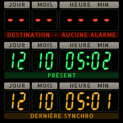

# Kronograf

Firmware de montre pour **LilyGO T-Watch 2020 V1** : cadran de chronographe d'aviation et afficheurs 7 segments « circuits temporels ». PlatformIO + Arduino-ESP32 + LVGL 8.3, avec un simulateur macOS qui compile exactement la même interface.

> État : **Tranches 0 à 2** (fondations ; cadran Chronographe aviateur, NTP, veille et réveils, mode atelier OTA ; cadrans Circuits temporels et Nuit, glissé entre cadrans). Voir `DECISIONS.md` pour le journal des choix et `BLOCKERS.md` pour les problèmes rencontrés.

| Chronographe aviateur | Circuits temporels | Nuit |
|---|---|---|
|  |  |  |

Captures prises sur la montre (console série/TCP) ; leurs équivalents simulateur sont dans `docs/screens/sim/`.

## Prérequis

```sh
brew install platformio sdl2 cmake
git submodule update --init            # LVGL 8.3.11
python3 -m venv .venv && .venv/bin/pip install pyserial==3.5
```

## Simulateur

```sh
cmake -S sim -B sim/build -DCMAKE_BUILD_TYPE=Release && cmake --build sim/build -j8
sim/build/kronograf_sim                                    # fenêtre ×3, souris = doigt
KG_TIME=10:09:30 sim/build/kronograf_sim --shot out.png    # capture PNG headless
```

Variables de la HAL simulée : `KG_TIME`, `KG_BATT`, `KG_STEPS`, `KG_REV`.

## Montre

```sh
pio run -e twatch-v1 -t upload --upload-port /dev/cu.usbserial-XXXX
```

Utiliser `/dev/cu.usbserial-*` (et non `cu.SLAB_USBtoUART`). 230 400 bauds : le câble actuel produit du bruit au-delà.

### Mode atelier (Wi-Fi, sans câble de données)

Montre sur USB (alimentation) et `include/secrets.h` renseigné : la montre reste en Wi-Fi.

```sh
pio run -e twatch-v1-ota -t upload                   # mise à jour OTA (kronograf.local)
tools/kg.py --host kronograf.local status            # console TCP 2323, mêmes commandes
```

Débranchée, le Wi-Fi est coupé.

### Console série

```sh
tools/kg.py status                                   # mémoire, FPS, batterie, révision
tools/kg.py screenshot docs/screens/device/x.png     # capture LVGL → PNG
tools/kg.py lcdtest                                  # mire rouge | vert | bleu 5 s
tools/kg.py battlog                                  # journal d'autonomie (dernière période sur batterie)
tools/kg.py sleep | wake | bl <8-255> | timeout <s> | touch [s] | diag
tools/kg.py face <0-2> | egg | coredump [erase] | coredump-raw f.bin | reboot
tools/kg.py log 3
```

## Sauvegarde et restauration du firmware d'origine

La flash d'origine (16 Mo) est sauvegardée dans `backups/` (hors git ; SHA-256 dans `DECISIONS.md` D8). Pour la restaurer :

```sh
esptool.py --port /dev/cu.usbserial-XXXX --baud 230400 write_flash 0 backups/twatch-original-20261012.bin
```

## Arborescence

```
src/ui/          interface LVGL (identique montre / simulateur), thème, polices
src/hal/hal.h    interface matérielle vue par l'UI
src/hal/device/  implémentation T-Watch (ST7789 esp_lcd, AXP202, PCF8563, console)
src/hal/sim/     implémentation simulée
sim/             harnais SDL2 + capture PNG
tools/           sauvegarde flash, génération des polices, console série
```

Polices : Barlow Condensed (SIL Open Font License, `assets/fonts/`).
