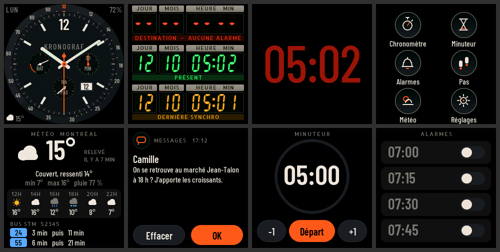

# Kronograf

**Firmware de montre pour la LilyGO T-Watch 2020**, écrit de zéro : un cadran de chronographe d'aviation, des afficheurs 7 segments façon « circuits temporels », la météo et les bus de Montréal, et les notifications de l'iPhone. ESP32, LVGL 8.3 et un simulateur macOS qui compile exactement la même interface.



> *English summary — Kronograf is a from-scratch firmware for the LilyGO T-Watch 2020 (ESP32, LVGL 8.3, PlatformIO/Arduino): an aviation chronograph face, a retro 7-segment "time circuits" face, a night face, stopwatch, timer, alarms, step counter, Open-Meteo weather, real-time Montréal STM bus departures (GTFS-RT parsed as a stream), and iPhone notifications over BLE (ANCS, passkey pairing). The UI is French. A macOS SDL2 simulator builds the very same UI code. Design notes and post-mortems live in `DECISIONS.md` and `BLOCKERS.md` (French).*

## Ce que fait la montre

| | |
|---|---|
| **Cadrans** | *Chronographe aviateur* (aiguilles lissées, compteurs batterie / minutes / pas, guichet date, complication météo, pastille de notifications) · *Circuits temporels* (trois rangées 7 segments : prochaine alarme, présent, dernière synchro) · *Nuit* (heure seule, rouge sombre, rétroéclairage réduit). Glissé horizontal entre cadrans. |
| **Apps** | Chronomètre, minuteur, alarmes, pas sur 7 jours, météo + bus, réglages — un lanceur 2 × 3 dessiné comme des sous-cadrans. |
| **Météo** | [Open-Meteo](https://open-meteo.com) (sans clé) : conditions, ressenti, 6 heures à venir, pictogrammes vectoriels ; âge du relevé ou « hors ligne ». |
| **Bus STM** | Passages en temps réel aux arrêts choisis (jusqu'à 3), depuis le flux GTFS-RT de la STM (~1 Mo, lu en flux sur la montre, certificat épinglé). Clé API facultative. |
| **iPhone** | Notifications via ANCS (Bluetooth basse consommation) : carte à l'arrivée avec vibration, liste, « Effacer » ou « Refuser » renvoyés à l'iPhone. Appairage protégé par code à 6 chiffres. |
| **Heure** | NTP à la demande (Wi-Fi allumé quelques secondes puis coupé), RTC PCF8563 en secours. |
| **Énergie** | Sommeil léger écran éteint, réveil au bouton, poignet levé ou double tape (BMA423), échéances d'alarme et de minuteur respectées en veille. |

Tout le texte est en français (accents compris) avec des polices sous licence OFL. Le matériel absent d'une révision (GPS, carte SD…) est détecté au démarrage et n'apparaît pas dans l'interface.

## Matériel

LilyGO **T-Watch 2020 V1** (ESP32-D0WDQ6, 16 Mo de flash, 4 Mo de PSRAM, écran ST7789 240 × 240, AXP202, BMA423, PCF8563, FT6336, vibreur, haut-parleur MAX98357A, infrarouge). Des environnements V2 et V3 existent dans `platformio.ini`, mais seule la V1 a été testée.

## Démarrage rapide

```sh
brew install platformio sdl2 cmake
git clone --recurse-submodules <url-du-dépôt> kronograf && cd kronograf
cp include/secrets.example.h include/secrets.h   # facultatif : Wi-Fi, clé STM, mot de passe OTA
```

### Simulateur (macOS)

```sh
cmake -S sim -B sim/build -DCMAKE_BUILD_TYPE=Release && cmake --build sim/build -j8
sim/build/kronograf_sim                                       # fenêtre ×3, la souris fait le doigt
KG_TIME=10:09:30 sim/build/kronograf_sim --shot capture.png   # capture PNG sans fenêtre
```

La HAL simulée se pilote par variables d'environnement : `KG_TIME`, `KG_FACE`, `KG_APP` (`chrono`, `notifs`…), `KG_BATT`, `KG_STEPS`, `KG_REV`, `KG_WX_CODE`, `KG_WX_TEMP`, `KG_BUS_STOPS`, `KG_BLE`, `KG_NOTIF_CAT`, `KG_ALERT`…

### Montre

```sh
# Avant toute chose : sauvegarder la flash d'origine (16 Mo, quelques minutes)
tools/backup_flash.sh

pio run -e twatch-v1 -t upload --upload-port /dev/cu.usbserial-XXXX
```

Utiliser `/dev/cu.usbserial-*` plutôt que `cu.SLAB_USBtoUART`.

**Mode atelier.** Montre sur USB et Wi-Fi configuré : la montre reste connectée, accepte les mises à jour OTA et ouvre une console TCP. Débranchée, le Wi-Fi est coupé.

```sh
pio run -e twatch-v1-ota -t upload        # OTA vers kronograf.local
tools/kg.py status                        # console : TCP si la montre est joignable, sinon série
```

### Secrets et configuration

`include/secrets.h` est ignoré par git ; `include/secrets.example.h` en donne le modèle. Une valeur vide désactive proprement la fonction correspondante.

| Clé | Rôle |
|---|---|
| `KG_WIFI_SSID`, `KG_WIFI_PASS` | Réseau par défaut (on peut aussi le choisir sur la montre : Réglages → Wi-Fi) |
| `KG_STM_API_KEY` | Clé du [portail développeurs STM](https://portail.developpeurs.stm.info) pour les bus |
| `KG_OTA_PASS` | Mot de passe des mises à jour OTA (conseillé) |

Les arrêts de bus se saisissent sur la montre (Réglages → Bus STM). La position météo est dans `src/data/kg_weather.h` (Montréal par défaut).

**Appairer un iPhone.** iOS ne liste pas un accessoire BLE générique dans Réglages → Bluetooth. Au premier contact, ouvrez une app comme *nRF Connect* et touchez « Connect » à côté de « Kronograf », puis saisissez le code affiché par la montre. Ensuite, l'iPhone se reconnecte tout seul.

## Console de diagnostic

`tools/kg.py <commande>`, par le port série ou par TCP en mode atelier :

```
status        mémoire, FPS, batterie, cause du dernier redémarrage
screenshot f  capture LVGL → PNG          lcdtest      mire R | V | B hors LVGL
battlog       journal d'autonomie          conso <min>  courant mesuré sur USB, batterie simulée
meteo [maj]   bus [maj | arrets <codes>]   ble [on | off | oublier]
sleep | wake | bl <n> | timeout <s> | face <n> | app <nom> | timer <s> | coredump | reboot
```

## Architecture

```
src/ui/          interface LVGL, identique montre / simulateur (cadrans, apps, thème, polices)
src/data/        code C pur et testé sur l'hôte : Open-Meteo, GTFS-RT (protobuf en flux), ANCS
src/hal/hal.h    seule interface matérielle vue par l'UI
src/hal/device/  T-Watch : écran (esp_lcd, DMA), AXP202, BMA423, réseau, BLE, garde-fous
src/hal/sim/     implémentation simulée
sim/             harnais SDL2 et captures PNG
tests/           tests des analyseurs (cc -I src tests/test_data.c src/data/kg_*.c)
tools/           sauvegarde et flash par blocs, console, polices, planches de captures
```

Quelques choix structurants, détaillés dans [`DECISIONS.md`](DECISIONS.md) :

- **Une UI, deux cibles.** L'interface ne connaît que `hal.h` ; le simulateur compile les mêmes fichiers. Toutes les captures du dépôt viennent de l'un ou de l'autre.
- **Aucun réglage de la tension du cœur ESP32.** Contrairement à certains firmwares, Kronograf ne touche jamais à DCDC3 de l'AXP202 et ne coupe jamais l'alimentation de l'ESP32.
- **Réseau par travaux.** Une tâche de fond enchaîne synchro NTP, météo et bus sur une seule connexion, puis coupe le Wi-Fi.
- **Mémoire.** Le tas LVGL et les gros tampons TLS sont en PSRAM, ce qui garde plus de 30 % de RAM interne libre avec BLE, Wi-Fi et HTTPS actifs.
- **Garde-fous.** Le chien de garde RTC fonctionne avec des « miettes de pain » en mémoire RTC, avec en plus des coredumps en flash et un mode sans échec : après trois plantages précoces, le BLE n'est plus démarré et l'OTA reste joignable.

## État du projet

Le développement a avancé par tranches, chacune flashée et vérifiée sur la montre.

- ✅ **0–3** : diagnostic matériel, cadrans, veille et réveils, lanceur, chronomètre, minuteur, alarmes, pas, réglages, sons, vibreur.
- ✅ **4** : météo et bus STM.
- ✅ **5** : notifications iPhone.
- 🔜 **6** : télécommande infrarouge.
- 🔜 **7** : finitions et campagne d'autonomie.

**Limites connues.** Cette carte n'a pas de quartz 32 kHz, donc le sommeil léger est impossible tant que le BLE est actif : l'autonomie avec notifications est en cours de mesure (D41). Le connecteur micro-USB de l'exemplaire de développement est capricieux (B2), d'où l'OTA et le flash par blocs.

## Licence et remerciements

Code de Kronograf sous [licence MIT](LICENSE). Dépendances et ressources :

- [LVGL](https://lvgl.io) 8.3 (MIT), [NimBLE-Arduino](https://github.com/h2zero/NimBLE-Arduino) (Apache 2.0), [XPowersLib](https://github.com/lewisxhe/XPowersLib) et [SensorLib](https://github.com/lewisxhe/SensorLib) (MIT), [stb_image_write](https://github.com/nothings/stb) (domaine public / MIT).
- Polices [Barlow Condensed](https://fonts.google.com/specimen/Barlow+Condensed) et [Allerta Stencil](https://fonts.google.com/specimen/Allerta+Stencil), sous licence SIL Open Font License (`assets/fonts/OFL-*.txt`).
- [My-TTGO-Watch](https://github.com/sharandac/My-TTGO-Watch) et la bibliothèque LilyGO ont servi de référence pour le brochage et les séquences d'initialisation, sans reprise de code (voir `docs/AUDIT.md`).
- Météo : [Open-Meteo](https://open-meteo.com) (CC BY 4.0). Bus : données ouvertes de la [STM](https://www.stm.info/fr/a-propos/developpeurs).
